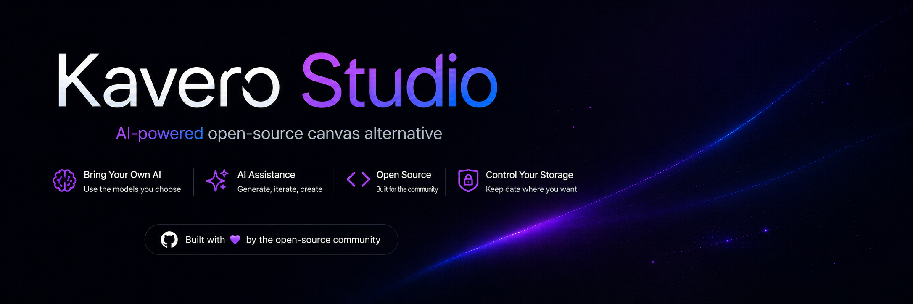
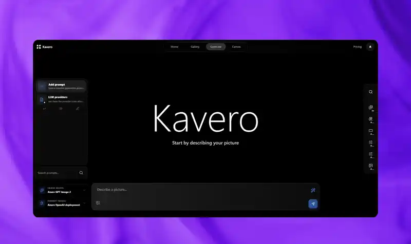

<div align="center">



### From prompt to polished design.

Generate with your own models, create on an AI-assisted canvas, and keep every file under your control.



</div>

Kavero is an open-source design workspace for people who want AI-powered creative tools without being locked inside one closed platform. It gives you a familiar visual canvas, generated asset history, AI-assisted editing workflows, provider-key control, and a local-first path you can run on your own machine.

## Why Kavero

Creative tools are turning into closed bundles: their models, their storage, their workflow, their pricing. Kavero is built around a different idea.

You should be able to bring your own models, keep control of your files, run the core product yourself, and still get a polished design workspace that feels approachable from the first click.

Kavero is for creators, founders, marketers, small agencies, and builders who need to make social posts, launch graphics, ads, thumbnails, pitch visuals, and client assets without handing the whole workflow to a closed suite.

## Highlights

- **Familiar canvas**: create designs with text, shapes, images, pages, assets, and PNG export.
- **AI generation**: generate visuals with prompt presets, references, model settings, and saved history.
- **Canvas AI**: use AI workflows for layout help, segmentation, asset generation, and image judging.
- **Gallery**: keep generated images organized and bring them back into your work.
- **BYOK provider keys**: keep AI access tied to your own provider accounts.
- **Own your storage**: use local managed storage or connect external storage flows.
- **Local-first setup**: run Kavero with the bundled Docker Compose Supabase stack.
- **Self-hostable foundation**: configure Kavero against your own Supabase-backed deployment.

## Get Started

Prerequisites:

- Node.js 22+ or 24+
- pnpm
- Docker Desktop or Docker Engine with Docker Compose, installed and running

```bash
pnpm install
pnpm run setup
```

Choose **Local Docker** in the setup wizard. The CLI asks for your first image-model source: **Local models** first, **API provider**, or **Set up models later**. Local requires Windows x64; unavailable choices are shown as disabled. Next, select a supported starting local model, or choose an image provider, enter its credentials and select a starting image model. Local and setup-later paths do not require provider keys.

This chooses a starting model, not an exclusive mode: choosing an API provider or setup later does not disable Local or clear existing providers. The CLI prints a model-specific **Model Hub** link. After launch, sign in and follow that link to review and set up your selection; local hardware checks, terms acceptance and downloads happen there. The current runnable local choices are Qwen Q4/Q3, while other imports are not automatically runnable. You can add models from either source, change the active model and remove configurations where supported in Model Hub. Chat models are configured independently; removing a configuration is separate from deleting downloaded files.

Selecting Local requests Local enablement. To enable Local later on supported Windows, rerun setup and choose Local. If an existing disabled setting is preserved, the CLI tells you; allow updates to non-secret values when you want to change it. Starter links guide model review without automatically activating a model or overriding an existing recovery request.

If you let the wizard start Kavero, leave that terminal open. Otherwise, start it with:

```bash
pnpm setup:run
```

The first Docker build can take several minutes. Wait for the **app** service to print `Ready`, then open [Kavero](http://127.0.0.1:3000). The terminal keeps streaming service logs while Kavero runs; it does not return to the prompt.

Create an account on the sign-in page using an email and password. The default local setup does not require Google sign-in.

The setup wizard creates local env files safely and protects existing secrets. Use `pnpm run setup` explicitly: `pnpm setup` is pnpm's own installation command.

The public homepage is at `/`; the app launcher is at `/dashboard`. Local and hosted installations use the same pages and navigation. Normal sign-in opens Dashboard, while links to a specific tool return you to that tool after signing in.

On supported Windows x64 machines, **Generate → Local** offers the user-selected Qwen image research profile. Kavero checks the GPU/RAM, shows the pinned model terms, and downloads and installs the engine, model, encoder and VAE after you accept. No separate ComfyUI installation, planning model or paid provider key is needed. Initial support is one NVIDIA RTX 30/40 GPU with at least 8 GB VRAM and 16 GB RAM; other eligible GPUs have no measured timing yet. Operators can disable Local by setting `KAVERO_LOCAL_GENERATION_ENABLED=0` in `.env.docker.local` before starting the stack.

For the separate Windows companion that connects a PC to a Kavero website, see [Kavero Connect](#kavero-connect-private-windows-preview).

Local generation saves to the configured destination; inference on your GPU does not change that destination. The default Docker setup uses local managed storage and does not need Google sign-in. Deployments configured for Drive use a separate **Settings → Storage → Connect Drive** connection; live acceptance of local-generation Drive saves is still pending.

Model Hub starts with an editable popular-family collection including Qwen, FLUX, Stable Diffusion, Z-Image, MiniMax and Hunyuan. The catalog is `src/modules/model-providers/local/popular-image-models.json`; verified publisher logos are bundled under `public/models/catalog` with source/hash attribution. These are curated starting picks, not an automatic live top-six ranking. Open a family to select an official repository or a clearly labeled community package; file choices and licenses are inspected from Hugging Face on selection. **Browse Hugging Face** retains live search, task/format filters and paging, and **Add from Hugging Face** accepts custom links. Catalog inclusion does not grant compatibility: installation still requires a verified recipe, currently Qwen Q4/Q3. Local/remote GPU destination assessment is deferred. Use `pnpm.cmd dev:local` for hot reload; bundled helper code changes still require an orderly `setup:run` restart.

Model Hub navigation is **Local models | Remote | Cloud providers**. Remote reuses Kavero Connect pairing/status and now has its own popular/live catalog plus **Check a model link**. Select a model destination, open a source, and explicitly check compatibility to see runtime, hardware, storage, permission and availability evidence. Remote metadata does not require the local helper; existing private Connect/origin/account gates still apply. Missing measurements remain Not verified; reported GPU totals alone do not establish candidate compatibility. A fresh matching active binding can identify an existing verified workload. This preview does not install models, grant permission, or select a generation destination. Local model details have the same check section while keeping their existing terms/setup flow. Direct entry is `/settings/models?source=remote`; `source=computers` remains an alias. Generic remote installation and missing companion measurements remain future work.

## Choose Your Setup

### Local Docker

Recommended for trying Kavero with the full local stack.

After completing the first-time setup above, subsequent launches only need:

```bash
pnpm setup:run
```

Leave the terminal open and visit [http://127.0.0.1:3000](http://127.0.0.1:3000) once the app prints `Ready`. Stop the attached stack with **Ctrl+C**. Accounts and files persist in Docker volumes across normal restarts.

If startup fails, run this from the Kavero project folder and check the reported failures:

```bash
pnpm setup:doctor
```

On Windows PowerShell, if execution policy blocks `pnpm.ps1`, use `pnpm.cmd` instead, for example `pnpm.cmd setup:run`. If you need help, include the failing command and its error text; keep `.env` values and secrets private.

Local Docker runs:

- Kavero app
- LiteLLM gateway, internal to the Docker network
- Supabase Auth
- Postgres
- PostgREST
- Supabase Storage
- Supabase bootstrap checks
- Local managed file storage through a Docker volume

Local Docker uses email/password sign-in and this storage contract:

```env
KAVERO_DEPLOYMENT_PROFILE=local-first
KAVERO_AUTH_MODE=password
KAVERO_STORAGE_PROVIDER=kavero-managed
KAVERO_MANAGED_STORAGE_BACKEND=local-filesystem
KAVERO_LOCAL_STORAGE_ROOT=/data/kavero-storage
```

`/data/kavero-storage` is a container path backed by the `kavero-local-storage` Docker volume.

Manual Docker command (app and backend services only):

```bash
docker compose --env-file .env.docker.local up --build
```

Use `pnpm setup:run` for the full supported Windows Local image-generation setup: it also starts Kavero's managed host helper and connects it to the Docker app. The manual Compose command does not perform that host setup.

The LiteLLM service is not published to the host by default. Kavero receives only server-side gateway envs inside the Docker network.

`pnpm run setup` generates the local LiteLLM secrets and can collect optional server-side Gemini, OpenAI, Groq, and Ollama values for the gateway. Normal setup does not require editing `docker/litellm/config.yaml`.

### Host Development

#### Windows local models with hot reload

For an existing Windows Local Docker installation, keep this running in terminal 1:

```bat
pnpm.cmd setup:run
```

Stop any earlier bare `pnpm dev` process with Ctrl+C. In terminal 2, from the same project folder, run:

```bat
pnpm.cmd dev:local
```

Open **http://127.0.0.1:3001** and sign in with your existing local account. UI/API source changes reload automatically. The Docker app remains at port 3000.

`dev:local` loads `.env.docker.local`, maps server connections to loopback, and authenticates the already-running private helper before starting Next.js. It needs no copied `.env.local`, PowerShell assignments, `node -e`, or `--env-file` Node flags. Helper credentials stay in the child server environment; they are not printed, put in browser variables, or written to env files. The command attaches only: stopping it leaves the original helper running. Keep terminal 1 open; bundled native/helper code changes still require an orderly launcher restart.

Development uploads/saves use `.kavero/dev-storage`, separate from the Docker storage volume. Auth, model records and history metadata use the same database; existing Docker-volume image files are not accessible from this host dev process. This is not an isolated database sandbox. Use port 3000 for verifying existing stored images.

Local image models do not require LiteLLM. For cloud-provider calls from the host dev server, additionally publish the gateway with `docker compose --env-file .env.docker.local -f compose.yml -f compose.dev.yml up -d litellm`; its host URL is `http://127.0.0.1:4000`.

#### Host development with separately configured services

Use this path when you want to run the Next.js dev server on your host machine while keeping LiteLLM in Docker as a local dependency.

```bash
cp .env.local.example .env.local
pnpm gateway:up
pnpm dev
```

On Windows PowerShell:

```powershell
Copy-Item .env.local.example .env.local
pnpm gateway:up
pnpm dev
```

Host development uses:

- `.env.local` for the Next.js app running on your machine
- `compose.dev.yml` to publish only LiteLLM on `127.0.0.1:4000`
- `compose.yml` for the same LiteLLM config used by Local Docker

Set these in `.env.local`:

```env
NEXT_PUBLIC_SITE_URL=http://localhost:3000
KAVERO_API_ORIGIN=http://localhost:3000
KAVERO_MODEL_GATEWAY=litellm
KAVERO_LITELLM_BASE_URL=http://127.0.0.1:4000
KAVERO_LITELLM_API_KEY=sk-change-me
LITELLM_MASTER_KEY=sk-change-me
GEMINI_API_KEY=
```

For the current local dev gateway, `KAVERO_LITELLM_API_KEY` should match `LITELLM_MASTER_KEY`. Add a real `GEMINI_API_KEY` or another provider key for live model calls.

If you use Google auth while developing on `localhost:3000`, add this redirect URL in Supabase Auth:

```txt
http://localhost:3000/auth/callback
```

Stop the dev gateway when finished:

```bash
pnpm gateway:down
```

### Cloud / Self-Host

Use this path when you already have a Supabase project or a hosted Supabase-compatible stack.

```bash
pnpm run setup
pnpm kavero doctor cloud-self-host
pnpm build
pnpm start
```

Minimum env shape:

```env
NEXT_PUBLIC_SUPABASE_URL=
NEXT_PUBLIC_SUPABASE_PUBLISHABLE_KEY=
SUPABASE_SERVICE_ROLE_KEY=
NEXT_PUBLIC_SITE_URL=
KAVERO_DEPLOYMENT_PROFILE=cloud
KAVERO_AUTH_MODE=google
```

Optional provider-owned storage:

```env
GOOGLE_DRIVE_CLIENT_ID=
GOOGLE_DRIVE_CLIENT_SECRET=
```

Optional Kavero-managed storage:

```env
KAVERO_STORAGE_PROVIDER=kavero-managed
KAVERO_MANAGED_STORAGE_BACKEND=supabase-storage
```

Optional hosted LiteLLM gateway:

```env
KAVERO_MODEL_GATEWAY=litellm
KAVERO_LITELLM_BASE_URL=
KAVERO_LITELLM_API_KEY=
KAVERO_LITELLM_ROUTING_SECRET=
```

Keep LiteLLM credentials, the routing secret, upstream provider keys, and internal gateway URLs server-only. A hosted external LiteLLM service must run the matching Kavero custom-auth hook with the same routing secret and pinned LiteLLM contract; an unmodified LiteLLM endpoint is not supported for dynamic client routing.

Azure OpenAI orchestration and image generation use independent logical configurations. Orchestration uses the `AZURE_API_*` record; Azure GPT Image 2 uses the `AZURE_IMAGE_*` record. The same resource URL and key may be entered explicitly in both records, but values are never copied or inferred between them. See [Azure OpenAI setup](docs/azure-openai-setup.md).

OpenAI orchestration offers stable Kavero aliases for `gpt-5.6`, `gpt-5.6-sol`, `gpt-5.6-terra`, and `gpt-5.6-luna`.

## Kavero Connect (private Windows preview)

Kavero Connect runs image generation on your Windows PC for a paired Kavero account. The website handles requests, downloads and Gallery saving. The companion and the website are separate applications: installing or opening Connect does not start a Kavero website or its database.

Connect is currently a **private Windows x64 preview**, requiring .NET Framework 4.8 or later. macOS/Linux companions and a public installer download are not available. Fresh Windows installation, safe upgrades and public HTTPS delivery still need acceptance. The developer installer is not Windows publisher-signed; its private package signature is a separate integrity check.

### Install and open

Obtain `KaveroConnect-Setup.exe` from the operator of your private test deployment. When a local installer has been prepared, it is in `dist/KaveroConnect-Setup.exe`; `dist/` is generated output and is not included in a source checkout.

1. Double-click **KaveroConnect-Setup.exe** in File Explorer.
2. Click **Install on this PC** and wait for installation verification.
3. Click **Open companion**.

To open it again after closing it or restarting Windows, double-click the same installer and choose **Open companion**. The preview does not yet add a Start menu shortcut or start automatically at login. Keep the installer somewhere you can find it.

The installer bundles the companion's Node.js runtime. Launching the app does not require PowerShell, pnpm or manual engine configuration. Installation does not pair an account, accept model terms or download model files.

### Connect your account and prepare a model

Your operator must keep a Connect-enabled Kavero website running at the address shown in the companion. Use that website to sign in; the installer is bound to its configured address.

1. Open **Settings → Models (Model Hub)** on the website. Under connected computers, click **Connect computer**, enter a name and click **Get connection code**.
2. Enter the code in the companion and click **Pair**. If the code expires, request a fresh code on the website.
3. Compare the fingerprints shown on the website and companion. If they match, check the confirmation box on the website and click **Confirm computer**.
4. In the companion, click **Confirm account**. Review the website, account and fingerprint before approving that account's access.
5. Select a supported image model and click **Review & set up**. Review hardware compatibility, required disk space and all component terms. Setup begins only after you accept the displayed research/evaluation terms and click **Accept & set up**. Existing verified components are reused within the same installation.
6. Wait for **Model ready on this PC**, then click **Resume**. The website should show the computer as **Ready**.

The current Qwen research profiles target the supported Windows/NVIDIA hardware described under [Get Started](#get-started). The companion shows the selected model's actual compatibility and disk requirements. Pairing permission and model permission are separate; a paired computer is not necessarily ready to generate.

### Generate, save and close

On the website, open **Generate → My computer**, select your ready PC, enter a prompt and click **Create image**. The current Connect flow produces one 512 × 512 image with a prompt of up to 1,000 characters. When the result is available, use **Download PNG** or **Save to Gallery**. A paid provider key is not required for the supported local Qwen profile.

Keep the website and companion online for request delivery and result transfer. **Pause** prevents new jobs while allowing accepted work and result recovery to continue. **Quit** or the window's **X** closes the companion, including when the website is unavailable, and keeps pairing, model setup and unfinished jobs for reopening. Accepted native work may continue after the window closes; Quit is not cancellation. To cancel an image, use **Cancel original job** on the website.

Reopening starts paused. Keep using the same installation and browser account to recover an unfinished request, then Resume when ready. **Disconnect** is separate from Quit: it requires the website to confirm that accepted work has drained before removing the connection. **Remove app** in the installer removes companion code and retains model, result and connection data.

If the website cannot be reached, restore it at the address shown in Connect. Closing a local website's terminal can stop that website; reopening the companion alone will not restart it. If setup reports another local host using the engine, finish its jobs and stop it through its original launcher before retrying. Avoid running independent Local and Connect hosts against the same GPU ports.

For operators: Connect remains disabled by default in `.env.example`. Website delivery, native execution and results require their corresponding Connect gates and an origin matching the installer. Connect Gallery saving currently requires `kavero-managed` with `supabase-storage`; the default Local Docker filesystem destination does not establish Connect readiness. The current private developer artifact targets `http://127.0.0.1:3061`, while normal Local Docker runs at port `3000`. It needs a separately configured, opt-in development website at port `3061`; the installer does not redirect itself to port `3000`. HTTP loopback opt-in is development-only. This preview is not a public hosted release.

The separate `KAVERO_CONNECT_SETUP_ENABLED=0` flag keeps Remote model setup disabled. The private companion and gated website controls implement native checks, destination-bound review, Download, progress, Cancel and recovery using the original request key. The companion is not updated automatically. Installed consent/download/recovery and the full private website-to-companion journey still need user-run acceptance; keep this flag off for the current preview. Existing Local model setup and Generate behavior are unchanged.

## First Run

1. Open `http://127.0.0.1:3000`.
2. Create an account.
3. If using a hosted AI provider, go to Settings -> API keys.
4. Add that provider's key, or follow the Local/Connect model setup instructions for supported local generation.
5. Open `/generate` or `/canvas`.

From there, generate assets, keep them in Gallery, place them into the canvas, edit the design, and export when ready.

## Configuration

| File | Purpose |
|---|---|
| `.env.docker.local` | Local Docker stack. Created by `pnpm run setup`. |
| `.env.local` | Local development or Cloud/self-host env. |
| `.env.local.example` | Host development reference for `pnpm dev` plus Docker LiteLLM. |
| `.env.example` | Manual Cloud/self-host reference. |
| `.env.docker.local.example` | Manual Local Docker reference. |
| `compose.dev.yml` | Host development override that publishes LiteLLM to localhost. |

Important envs:

| Env | Used for |
|---|---|
| `NEXT_PUBLIC_SUPABASE_URL` | Browser-facing Supabase URL. |
| `NEXT_PUBLIC_SUPABASE_PUBLISHABLE_KEY` | Browser/server Supabase client key. |
| `SUPABASE_SERVICE_ROLE_KEY` | Admin-backed app flows and provider-key storage. |
| `NEXT_PUBLIC_SITE_URL` | Public Kavero app origin. |
| `KAVERO_DEPLOYMENT_PROFILE` | `cloud` or `local-first`. |
| `KAVERO_AUTH_MODE` | `google`, `password`, or `google-password`. |
| `KAVERO_STORAGE_PROVIDER` | Selects new-write storage behavior. |
| `KAVERO_MANAGED_STORAGE_BACKEND` | `supabase-storage` or `local-filesystem`. |
| `KAVERO_LOCAL_STORAGE_ROOT` | Absolute storage root, or `/data/kavero-storage` in Docker. |
| `KAVERO_MODEL_GATEWAY` | Server-side model gateway selector for LiteLLM-backed model calls. |
| `KAVERO_LITELLM_BASE_URL` | Server-side LiteLLM base URL. Uses `http://litellm:4000` in Docker and `http://127.0.0.1:4000` for host development. |
| `KAVERO_LITELLM_API_KEY` | Server-side Kavero-to-LiteLLM credential. |
| `KAVERO_LITELLM_ROUTING_SECRET` | Separate server-only HMAC secret shared with the matching Kavero LiteLLM custom-auth hook. |
| `KAVERO_MODEL_GATEWAY_CREDENTIAL_MODE` | Server-side credential policy: `env-or-user` (default), `user-required`, or `env-only`. |
| `LITELLM_MASTER_KEY` | Local LiteLLM service master key. Generated by setup for Local Docker. |
| `GEMINI_API_KEY` | Optional server-side Gemini key for the LiteLLM gateway. |
| `OPENAI_API_KEY` | Optional server-side OpenAI key for the LiteLLM gateway. |
| `GROQ_API_KEY` | Optional server-side Groq key for the LiteLLM gateway. |
| `AZURE_API_KEY` | Optional server-side Azure OpenAI key; requires all other Azure values. |
| `AZURE_API_BASE` | Azure OpenAI HTTPS endpoint such as `https://resource.openai.azure.com`. |
| `AZURE_API_VERSION` | Azure OpenAI API version used for orchestration requests. |
| `AZURE_DEPLOYMENT_NAME` | Account-specific Azure OpenAI deployment name; kept server-only. |
| `AZURE_BASE_MODEL` | Curated routing family: `gpt-4o`, `gpt-4.1`, `gpt-5`, `gpt-5.6-sol`, `gpt-5.6-terra`, or `gpt-5.6-luna`. GPT-5 families use LiteLLM's explicit `azure/gpt5_series/<deployment>` route. |
| `AZURE_IMAGE_API_KEY` | Azure image-slot key, supplied independently even when identical to `AZURE_API_KEY`. |
| `AZURE_IMAGE_API_BASE` | Azure image-slot resource URL, supplied independently even when identical to `AZURE_API_BASE`. |
| `AZURE_IMAGE_API_VERSION` | Validated Azure GPT Image 2 API version: `2024-02-01`. |
| `AZURE_IMAGE_DEPLOYMENT_NAME` | Azure GPT Image 2 deployment name; kept server-only. |
| `AZURE_IMAGE_BASE_MODEL` | Validated image family: `gpt-image-2`. |
| `OLLAMA_BASE_URL` | Optional server-side Ollama URL for the LiteLLM gateway. |

The setup CLI keeps existing non-empty values by default, asks before replacing secrets, writes through a backup, and never echoes secrets back to your terminal.

## Commands

| Command | Description |
|---|---|
| `pnpm run setup` | Guided setup wizard. |
| `pnpm setup:doctor` | Check Local Docker configuration. |
| `pnpm kavero doctor cloud-self-host` | Check Cloud/self-host configuration. |
| `pnpm setup:run` | Run Local Docker with `docker compose up --build`. |
| `pnpm gateway:up` | Start the LiteLLM Docker dependency for host development. |
| `pnpm gateway:down` | Stop the LiteLLM Docker dependency for host development. |
| `pnpm dev` | Start the Next.js development server. |
| `pnpm build` | Build for production. |
| `pnpm start` | Start the production server. |
| `pnpm test` | Run Vitest. |
| `pnpm test:smoke` | Run Playwright smoke tests. |

## Architecture

```txt
src/app                    Next.js routes and API route entrypoints
src/modules/canvas         Canvas editor runtime
src/modules/canvas/ai      Canvas AI workflows
src/modules/generation     Standalone /generate runtime
src/modules/gallery        Generated image history and Gallery runtime
src/modules/storage        Managed and connected storage foundation
src/modules/assets         Canvas asset helpers
src/modules/editor-panels  Canvas panel UI
src/lib                    Shared auth, Supabase, Drive, provider-key, and utility code
supabase                   Schema and local foundation SQL
docker                     Local Supabase Compose support
scripts                    Setup, bootstrap, and verification helpers
```

## Development

```bash
pnpm install
cp .env.local.example .env.local
pnpm gateway:up
pnpm dev
```

`pnpm dev` runs the app on the host. If you want LiteLLM-backed AI features during host development, keep `pnpm gateway:up` running and point `.env.local` at `http://127.0.0.1:4000`.

Useful checks:

```bash
pnpm exec vitest run scripts/setup
pnpm exec vitest run src/modules/generation
pnpm exec tsc --noEmit
pnpm build
```

The full suite includes local-generation installer tests that require **Node.js 24.11.1**, matching the verified managed runtime. Use that version for a complete `pnpm test` run; the installer deliberately rejects other runtime versions. Kavero provisions that runtime automatically for local model installation.

Local Supabase helper scripts are available when you want to work outside the Docker Compose app flow:

```bash
pnpm supabase:local:start
pnpm supabase:local:bootstrap
pnpm supabase:local:smoke
```

## License

Kavero is released under the Apache License 2.0.
